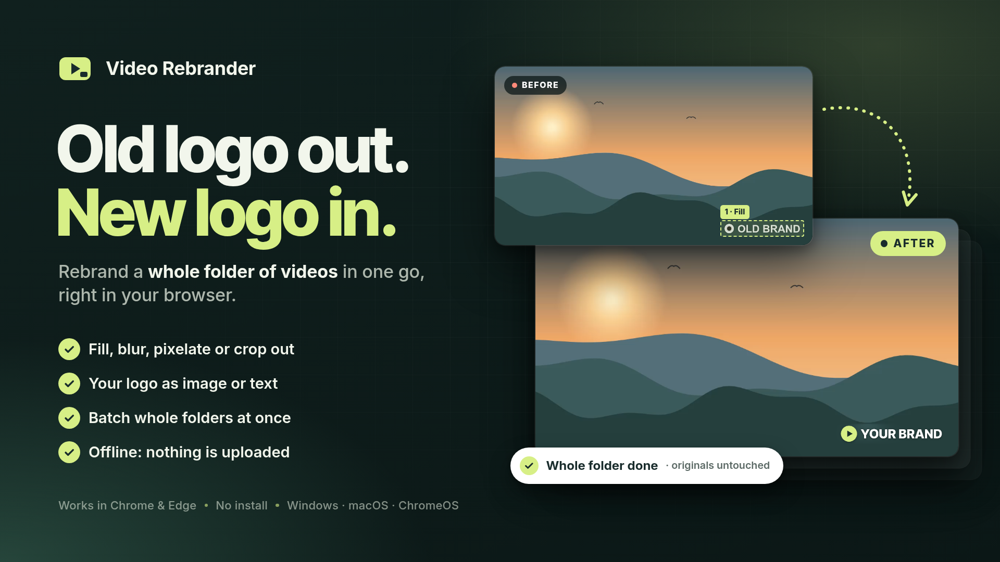

# Video Rebrander v1.0

Removes an old logo or watermark from a **whole folder of videos** and puts
**your new logo** in its place. It runs entirely in your browser.
**Nothing is uploaded.** Your original videos are never changed. New copies
are saved in a **Rebranded** folder.



> **Use it only for videos you own or have permission to edit.** Removing
> someone else's watermark so you can reuse their video can break copyright law.

---

## How to open it

1. Unzip this package anywhere, for example in `Downloads`.
2. Open the `VideoRebrander` folder and double-click **`index.html`**.
   You don't need to install anything, and it works offline.
3. Use **Google Chrome** or **Microsoft Edge** on a computer
   (Windows, macOS, or ChromeOS).

> **First time?** Click **Try a sample video**. It makes a practice video with
> an "OLD BRAND" logo, so you can try every step without touching your own files.

---

## Using it

1. **Choose videos.** Click **Choose folder** and pick the folder with your
   videos. Subfolders are included unless you turn off **Include subfolders**.
   You can also drag a folder onto the page. If a video can't be read, it's
   listed with the reason and skipped.
2. **Remove old logo.** Drag on the preview to draw a box over the old logo.
   Make the box a little bigger than the logo. Add more boxes if there's more
   than 1 logo. For each box, choose how to remove the logo:
   - **Fill** paints over the logo with the colors around it. This works best for most logos.
   - **Blur** softens the logo so it can't be read.
   - **Pixelate** covers the logo with large squares.
   - **Crop out** zooms in a little to cut the logo off. Use it for logos at the very edge.

   Drag the timeline to check the video at different moments.
   **Different video shapes get their own boxes.** A logo is usually in a
   different place in vertical (9:16) videos than in landscape (16:9) videos.
   The buttons under the preview show each shape and how many boxes it has.
   Click one to set up that shape.
3. **Add new logo.** Choose **Image** (a PNG with a transparent background works
   best) or **Text** (choose the font and color, and add a soft shadow if you want).
   - Pick 1 of 9 positions, or click **Where the old logo was** to put it
     where the first box is. This also hides any leftover blur from removing the old logo.
   - Or drag the new logo on the preview. Drag a corner to resize it.
   - Change **Size**, **Opacity**, and **Margin** with the sliders.

   Switch between **Result** and **Original** to compare.
4. **Save new copies.**
   - **Save to:** By default, copies go in a new **Rebranded** folder inside your
     folder, and your subfolders are kept. **Choose another folder** saves them
     somewhere else. If you choose the same folder as your videos, the copies
     are saved next to them with **(rebranded)** at the end of the name.
   - **Quality:** Same as original (recommended), Smaller files, or Best quality.
   - **If a new copy already exists:** Skip it to continue a run you stopped earlier, or replace it.
   - Select **I own these videos or have permission to edit them**, then click **Start**.
     Chrome or Edge asks once for permission to save in the folder. Choose **Allow**.
     It may say **Edit files** or **Save changes**.

While it works, you see the progress, the time left, and each finished video.
You can **Pause**, **Resume**, or **Stop**. Keep the tab open. You can use
other apps while it works, and the screen stays on. If you stop, click
**Start** again later. Videos that are already done are skipped.

Your boxes, new logo, and options are remembered on this computer for next time.

### Tips for clean results

- **Fill** works best on simple backgrounds like sky, walls, or plain colors.
  On busy backgrounds, it can leave a soft smudge. To cover it, put the new
  logo **Where the old logo was**.
- Logos must stay in the same place. The tool can't follow a logo that moves
  around or appears in different places.
- Large, see-through watermarks across the middle of the video can't be
  removed cleanly. **Blur** or **Pixelate** can hide them instead.

### Keyboard shortcuts (preview)

| Key | Action |
| --- | --- |
| `Delete` / `Backspace` | Remove the selected box |
| Arrow keys | Move the selected box or new logo (hold `Shift` to move faster) |
| `Esc` | Unselect |

---

## What you get

- **MP4 files** (H.264 video) with the same size and frame rate as the original.
- **Sound is kept.** If the sound format can't be saved in an MP4 file, the
  video is saved without sound, and you see a note about it.
- Phone videos recorded sideways are saved the right way up.
- HDR videos are saved as standard (SDR) video, so their colors can look a little different.
- Only the main video and the main sound track are kept. Subtitles and extra
  sound tracks are left out.
- If a video file is incomplete, the part that can be read is saved, and you
  see a note about it.

## Limits

- **File types:** MP4, MOV, M4V, WebM, and MKV.
- **Video formats:** H.264, VP8, VP9, and AV1 usually work. **HEVC (H.265)**,
  which iPhones often use, works only if your browser and computer support it.
  If they don't, the video is marked "can't be read in this browser." Try
  Microsoft Edge, or convert the video to H.264 first.
- **Speed** depends on your computer. In testing on a computer without a
  graphics card, 37 seconds of 1080p video took about 27 seconds.
- A removed logo isn't recovered. The tool estimates what was behind it from the area around it.

## Privacy

- Videos are read on your computer, inside the browser tab.
- Nothing is sent anywhere, and Video Rebrander works offline.
- Video Rebrander only adds new files to the folder you choose. It never
  changes or deletes your original videos.

---

## Package contents

```
VideoRebrander-Complete-Package/
├─ README.md                  ← this file
├─ THIRD-PARTY-NOTICES.txt
└─ VideoRebrander/
   ├─ index.html              ← open this
   ├─ styles.css
   ├─ app.js
   └─ lib/
      ├─ mediabunny.min.js     (reads and writes video files)
      └─ MEDIABUNNY-LICENSE.txt
```

## Credits

Video Rebrander uses [Mediabunny](https://github.com/Vanilagy/mediabunny) by
Vanilagy to read and write video files. Mediabunny is licensed under the
Mozilla Public License 2.0 (MPL-2.0). For details, see `THIRD-PARTY-NOTICES.txt`.
